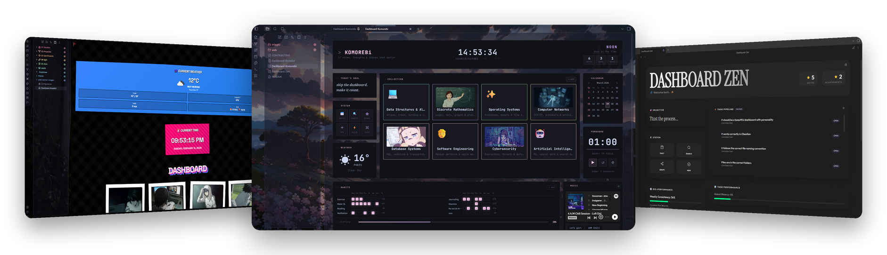
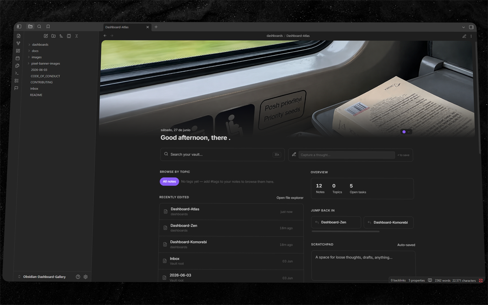
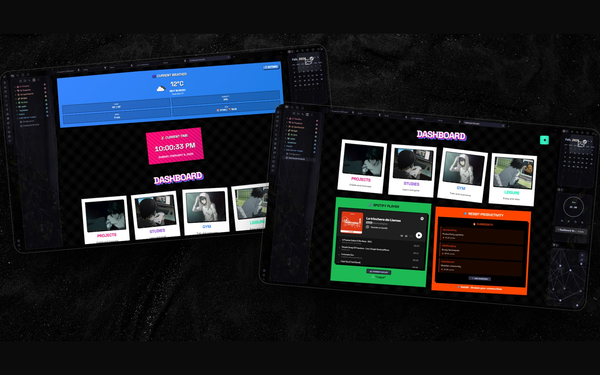
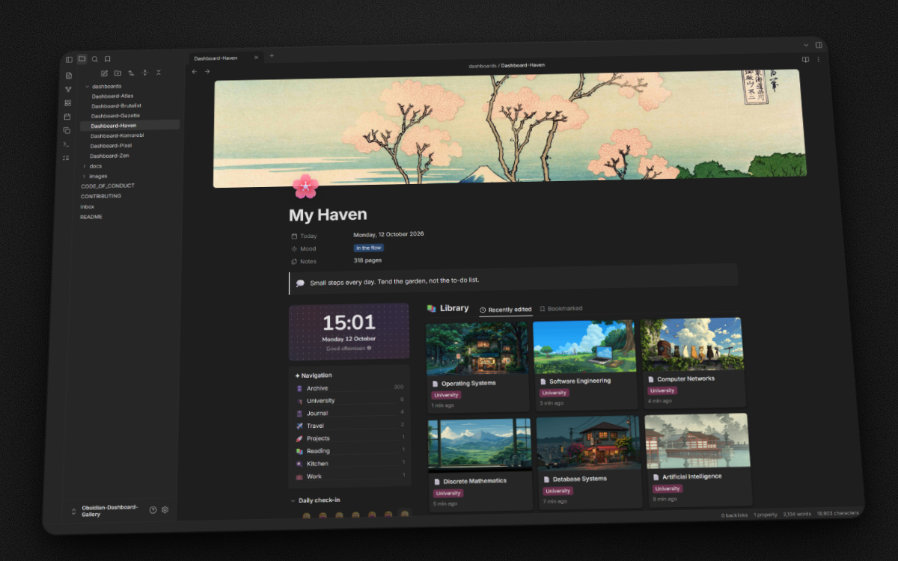
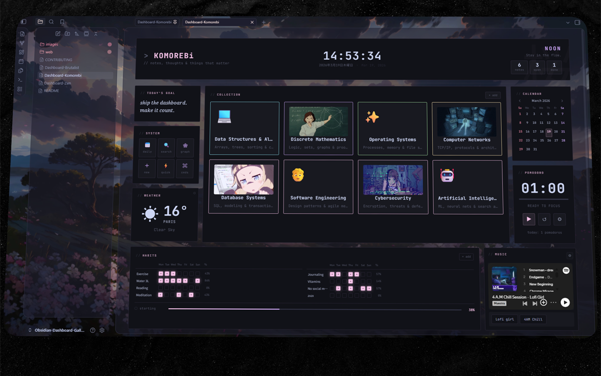
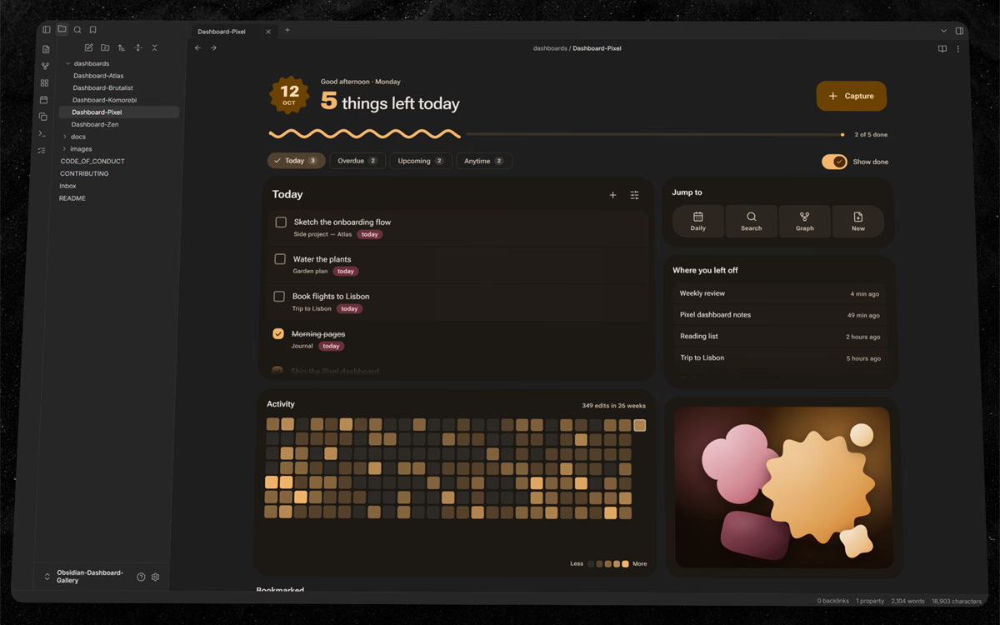
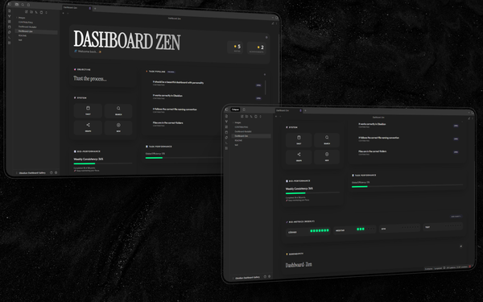

# Obsidian Dashboard Gallery

**Beautiful, ready-to-use dashboards for your Obsidian vault**

**English** · [Español](./docs/README_es.md) · [Português](./docs/README_pt.md) · [简体中文](./docs/README_zh.md) · [Website](https://obsidian.inlitx.xyz)

---

Six home dashboards for Obsidian. Copy two files into your vault — a note and a CSS snippet — and your home note looks like the shots above. No build step, no theme lock-in.

Screenshots, video previews and the full breakdown of every dashboard live on **[obsidian.inlitx.xyz](https://obsidian.inlitx.xyz)**.

## Gallery

<table>
<tr>
<td width="50%" valign="top">

<h3><a href="dashboards/Dashboard-Atlas.md">Atlas</a></h3>
Calm and theme-aware. Greeting, quick capture, tag filtering, activity heatmap, calendar and focus timer.  

</td>
<td width="50%" valign="top">

<h3><a href="dashboards/Dashboard-Brutalist.md">Brutalist</a></h3>
Loud blocks of colour, live weather, a big clock and photo cards for every area of your vault.  
 
</td>
</tr>
<tr>
<td width="50%" valign="top">

<h3><a href="dashboards/Dashboard-Haven.md">Haven</a></h3>
A cosy Notion-style home. Cover and page icon, callouts, a task database with Board, Table and Calendar views, a gallery of your notes, navigation, a clock and a daily check-in.  

</td>
<td width="50%" valign="top">

<h3><a href="dashboards/Dashboard-Komorebi.md">Komorebi</a></h3>
Terminal ricing with a soft edge. Collections, habit grid, weather, pomodoro and music.  
  
</td>
</tr>
<tr>
<td width="50%" valign="top">

<h3><a href="dashboards/Dashboard-Pixel.md">Pixel</a></h3>
Material 3 Expressive agenda with dynamic colour, shape morphing and spring motion. Tasks that write back to your notes, quick capture, a wavy progress meter and a picture from your vault — in light and dark.  

</td>
<td width="50%" valign="top">

<h3><a href="dashboards/Dashboard-Zen.md">Zen</a></h3>
Minimal glass surfaces, habit tracking and a scrolling task pipeline.  

</td>
</tr>
</table>

Click any preview for the full-size shot. Dataview needs *Enable JavaScript queries*; OpenWeatherMap needs a free API key, entered from inside the dashboard.

## Install

1. Install **Dataview** from Community plugins and turn on *Enable JavaScript queries* in its settings.
2. Copy `dashboards/Dashboard-<Name>.md` anywhere in your vault.
3. Copy `.obsidian/snippets/Dashboard-<Name>.css` into `<your vault>/.obsidian/snippets/`.
4. Enable the snippet in *Settings → Appearance → CSS snippets*, then open the note in Reading view.

Both files share the same name — pick one dashboard, take its pair, done.

## Contributing

Ideas, fixes and new dashboards are welcome. Read [CONTRIBUTING.md](CONTRIBUTING.md) before opening a pull request, and keep in mind the [Code of Conduct](CODE_OF_CONDUCT.md).

## License

[MIT](LICENSE) — use them, change them, ship them.

Made for the Obsidian community

